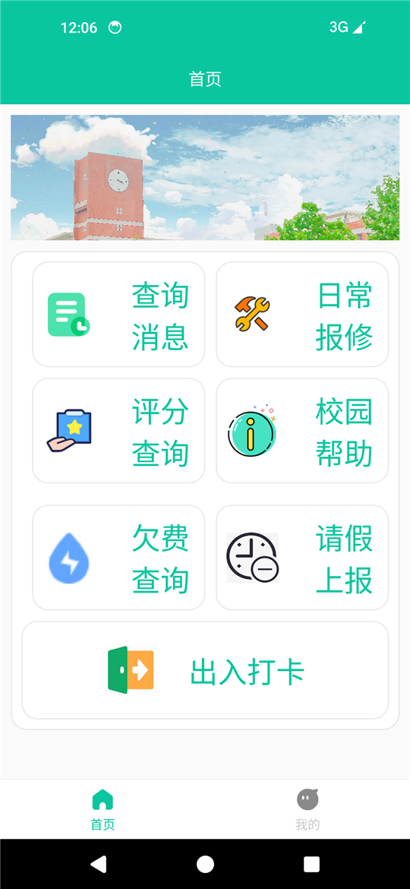
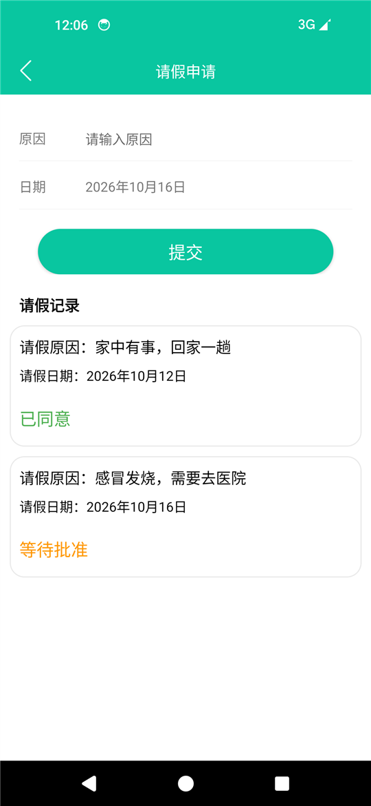
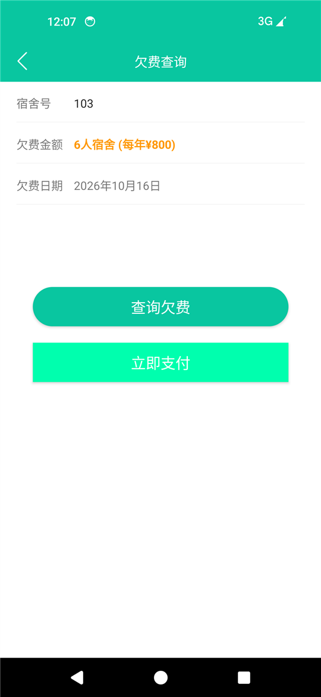
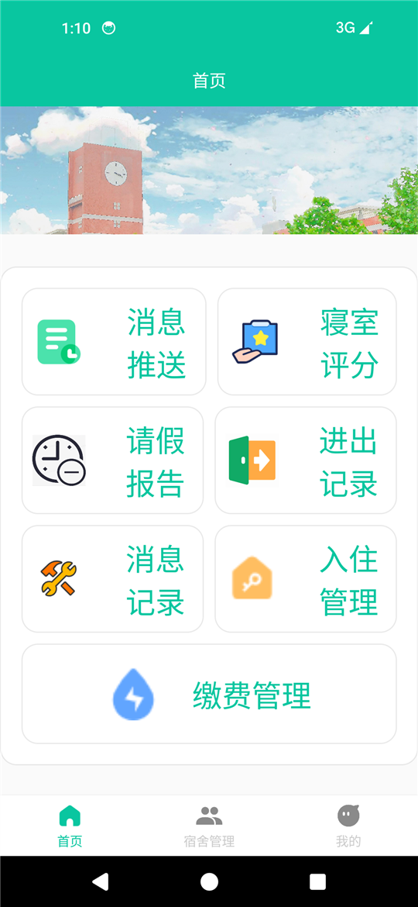
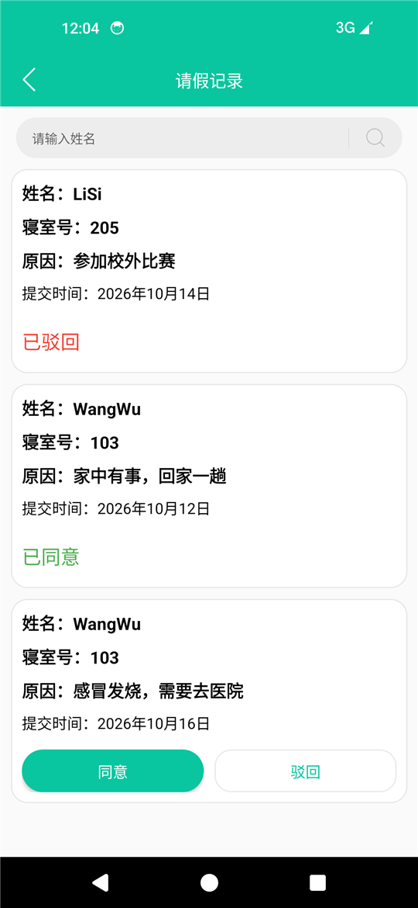
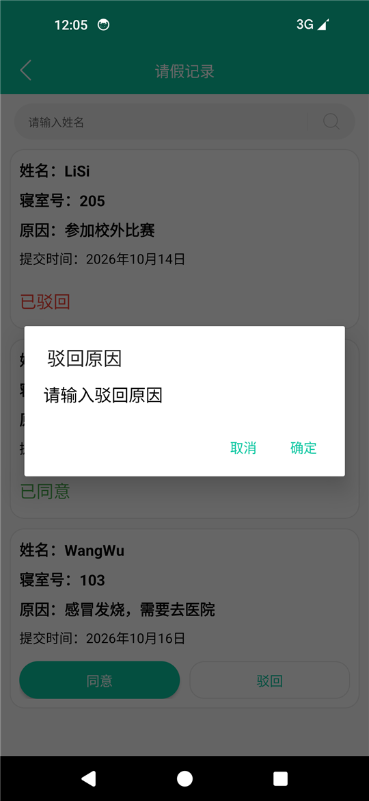
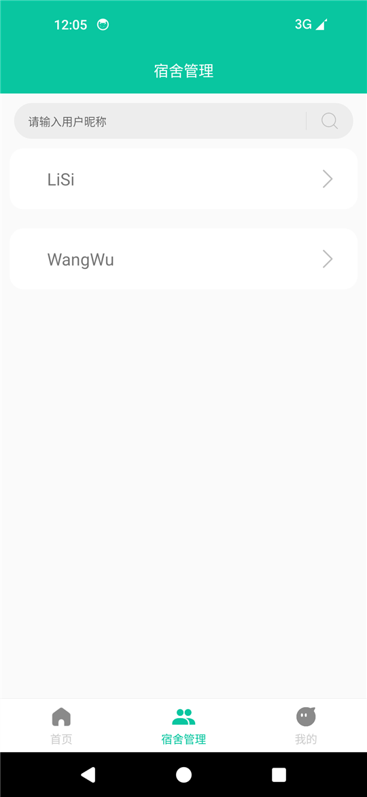
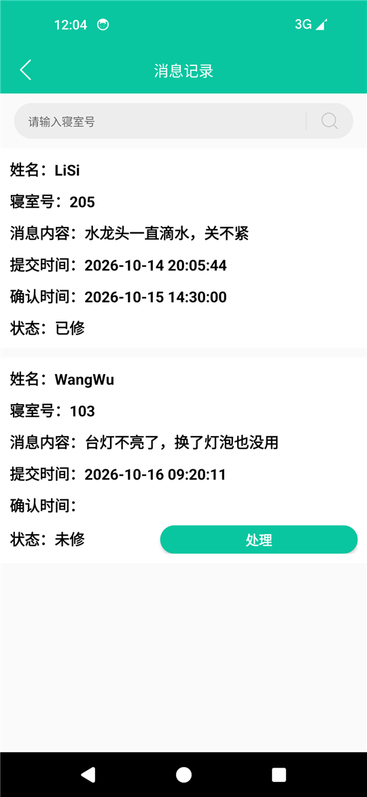
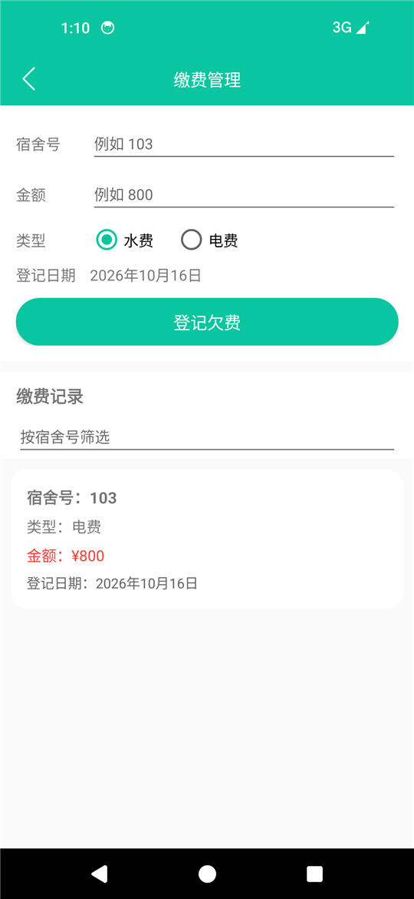

# StudentDormitory · 学生公寓管理系统

一个**纯本地的 Android 学生公寓管理系统**：Java 8 + Room，双角色（学生 / 管理员）权限区分，覆盖请假审批、报修、进出打卡、寝室评分、缴费管理、公告推送、访客登记等宿舍日常事务。

> 数据全部存在手机本地 SQLite / Room 中，无后端、无网络请求。
> 本仓库是**作品展示页**，包含可安装的 APK、界面截图与项目说明；源码不在此仓库（可在交流时提供）。

📦 **直接下载体验**：[`学生公寓管理系统.apk`](学生公寓管理系统.apk)
｜ 📄 **项目说明**：[`项目说明.md`](项目说明.md)
｜ 📖 **运行说明**：[`运行说明.txt`](运行说明.txt)

---

## 界面预览

<table>
<tr>
<td align="center" width="33%"><br><sub><b>学生首页</b> · 7 个功能入口</sub></td>
<td align="center" width="33%"><br><sub><b>请假上报</b> · 表单 + 本人记录与审批状态</sub></td>
<td align="center" width="33%"><br><sub><b>欠费查询</b> · 年费从 room_type 表读取</sub></td>
</tr>
<tr>
<td align="center"><br><sub><b>管理员首页</b> · 7 个管理模块</sub></td>
<td align="center"><br><sub><b>请假审批</b> · 待审核 / 已同意 / 已驳回</sub></td>
<td align="center"><br><sub><b>驳回</b> · 必须填写驳回原因</sub></td>
</tr>
<tr>
<td align="center"><br><sub><b>宿舍管理</b> · 学生增删改查</sub></td>
<td align="center"><br><sub><b>报修处理</b> · 一键标记已修</sub></td>
<td align="center"><br><sub><b>缴费管理</b> · 登记欠费 + 查看记录</sub></td>
</tr>
</table>

> 全部 18 张截图见 [`截图/`](截图/)

---

## 这个项目的重点

功能是课程设计的常规范围，**技术价值在于两次重构**。

### 第一次：把散落的手写 SQL 收敛成分层架构

| | 改造前 | 改造后 |
|---|---|---|
| 数据访问 | 每个页面自己 new Helper、自己拼 SQL、自己解析 Cursor | 8 个 DAO 统一负责，外部只看得见 Bean |
| 列取值 | `cursor.getInt(0)` 列位置硬编码，**89 处** | `getColumnIndexOrThrow("列名")` |
| 同一段映射 | 在 5 个文件里各抄一遍 | 只此一份 |
| 资源释放 | 13 处 Cursor 不关闭 | `try { ... } finally { close(); }` |
| 级联删除 | 无事务，可能半删 | `beginTransaction` + `setTransactionSuccessful` |

### 第二次：把手写 DAO 换成 Room

| | 手写 DAO | Room |
|---|---|---|
| 建表 | 手写 `create table` 字符串 | 由 `@Entity` 生成，**SQL 与 Java 字段不可能对不上** |
| SQL 写错 | 运行时才炸 | **编译期报错**（Room 把每条 SQL 拿到内存 SQLite 上真跑） |
| 事务 | 三件套 | 一个 `@Transaction` 注解 |
| 联表结果 | 往实体里塞"有时有值"的字段 | `@Embedded` + 独立的联表 POJO |

同时修复 **30+ 处缺陷**，含 6 个必崩问题（空指针、`String.format` 误用、`NumberFormatException`、废弃 Fragment 在 API 21 上崩溃）。

---

## 技术栈

| 项 | 版本 / 说明 |
|---|---|
| 语言 | Java 8 |
| 存储 | **Room 2.4.3**（9 张表，`AppDatabase` version 8，WAL 模式） |
| UI | RecyclerView + ViewBinding + 自定义 Adapter/ViewHolder |
| 第三方 | Glide（图片）、PictureSelector（相册选图） |
| 构建 | Gradle 8.9 · AGP 8.7.3 · JDK 17 |
| SDK | compileSdk 32 / targetSdk 33 / **minSdk 21** |
| 规模 | 71 个 Java 文件，约 7200 行；43 个布局 |

---

## 架构

```
app/src/main/java/com/example/studentdormitory/
├── bean/      (12)  8 个 @Entity + RoomType + 联表 POJO
├── enums/      (3)  角色 / 进出类型 / 报修状态
├── dao/        (9)  Room @Dao 接口：只有 SQL 与签名，没有一行 Java 逻辑
├── db/         (1)  AppDatabase：注册实体、单例、种子数据回调
├── adapter/    (9)  RecyclerView 适配器
├── util/       (3)  SharedPreferences / 键盘 / Glide 引擎
├── widget/     (1)  自定义 ActionBar
└── ui/
    ├── activity/ (28)
    └── fragment/  (4)  已迁移到 androidx.fragment.app.Fragment
```

数据层 9 张表：`user` · `repairs` · `temperature` · `come` · `score` · `task` · `pay` · `fang` · `room_type`

> `temperature` 表的语义已改为**请假**——列名保留但存的是请假原因，另带 `status`
> （0 待审核 / 1 已同意 / 2 已驳回）与 `rejectReason`。

---

## 几个能讲清的硬骨头

**① 一个查询静默返回空，完全不报错**

宿舍管理列表永远是空的，但同一条 SQL 在设备上用 `sqlite3` 手动执行却能查出数据。根因是**建表时列没有声明类型**——SQLite 的亲和性由声明类型决定，没声明就是 NONE 亲和性、不做任何类型转换，于是 `where userType = ?` 绑定文本 `"0"` 时，TEXT `'0'` 和库里存的 INTEGER `0` 匹配不上。

更反直觉的是：这个坑**恰恰是"有人为了安全改用占位符"那一刻才爆发的**——老代码用字符串拼接 `"where userType = " + 0`，拼进去的是数字字面量，碰巧能比上。

**② 管理员每次启动 App 都要重新登录**

根因是 `userId > 0` 被用来判断登录态，但管理员登录时存的 `USER_ID` 就是 `0`——**0 既是"管理员的哨兵值"，又是"没登录"的默认值，两个含义撞车了**。修法是加一个独立的 `IS_LOGIN` 标记。

**③ 从手写 DAO 迁移到 Room 的四个坑**

- `compileSdk` 是 32 → Room 只能用 2.4.x，而它不支持 `:#{#param.field}` 参数展开
- `sum()` 对空集返回 **NULL 而不是 0**，映射到基本类型 `double` 会失败 → 用 `coalesce(sum(money), 0)` 兜住
- 旧库没有 `room_master_table`，Room 的完整性校验会直接失败
- Room 默认禁止主线程查询，项目显式 `allowMainThreadQueries()` 放开——**这是有意的技术债**

---

## 已知边界

- **纯本地单机**：数据全在手机本地。因此"学生上报 → 管理员处理"只在**同一台设备**上成立——这是单机架构的固有边界，不是缺陷
- 无网络层（不含 HTTP / Retrofit）
- 密码明文存储，未做加盐哈希
- 尚无单元测试
- **数据库操作全在主线程**：Room 默认禁止这么做，本项目用 `allowMainThreadQueries()` 放开了。这是有意的取舍（改成异步要重写每个页面的数据流），但仍是技术债
- 升级用 `fallbackToDestructiveMigration()`：旧库升级时数据会清空，生产环境应写精确的 `Migration`

---

## 许可

课程设计延伸项目，用于教学与技术展示。
